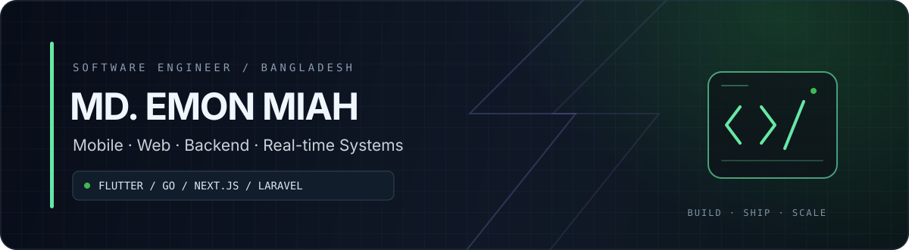

  
  
  

---

## 01 — The Engineer

I build **mobile products, full-stack web platforms, backend services, and real-time experiences**—with a focus on the architecture behind the interface.

My day-to-day toolkit centers on **Flutter, Go, Next.js, React, and Laravel/PHP**. I enjoy connecting clean product experiences with dependable APIs, realtime communication, secure authentication, and production-ready infrastructure.

> **My approach:** understand the system, simplify the architecture, ship with care, and make it maintainable for the next engineer.

## 02 — Engineering Toolkit

<table>
  <tr>
    <td width="50%" valign="top">
      <h3>📱 Mobile Engineering</h3>
      

        
      

      Flutter · Dart · GetX · Riverpod · Provider
    </td>
    <td width="50%" valign="top">
      <h3>🌐 Web & Frontend</h3>
      

        
      

      Next.js · React · TypeScript · Responsive UI
    </td>
  </tr>
  <tr>
    <td width="50%" valign="top">
      <h3>⚙️ Backend & APIs</h3>
      

        
      

      Go · Gin · GORM · Laravel · REST APIs · JWT
    </td>
    <td width="50%" valign="top">
      <h3>🗄️ Data & Messaging</h3>
      

        
      

      Relational data · Caching · Realtime events
    </td>
  </tr>
  <tr>
    <td width="50%" valign="top">
      <h3>📡 Real-Time & Streaming</h3>
      

        
        
        
        
      

      WebSocket · Socket.IO · WebRTC · LiveKit
    </td>
    <td width="50%" valign="top">
      <h3>🚢 Delivery & Infrastructure</h3>
      

        
      

      Docker · Linux · Nginx · CI/CD · GitHub Actions
    </td>
  </tr>
  <tr>
    <td colspan="2" valign="top">
      <h3>🏗️ Microservices & System Architecture</h3>
      

        
        
        
      

      Service boundaries · API-driven communication · Dockerized services · Scalable backend architecture
    </td>
  </tr>
</table>

## 03 — Systems I Like Building

  
<strong>📲 Mobile products & connected experiences</strong>

  
Cross-platform applications with predictable state management, thoughtful navigation, and clean API integration.

  
<strong>🧩 Full-stack platforms & admin systems</strong>

  
Business applications, e-commerce, ERP workflows, and administration tools that align with the underlying backend domain.

  
<strong>⚡ APIs, realtime communication & streaming</strong>

  
Go and Laravel services, authentication flows, live chat, WebSocket events, and streaming integrations.

  
<strong>🔐 Production engineering</strong>

  
Secure session/device handling, containerized services, deployment automation, and maintainable production environments.

## 04 — How I Work

**DISCOVER**　→　**DESIGN**　→　**BUILD**　→　**VERIFY**　→　**SHIP**

Practical architecture. Clear boundaries. Reliable delivery.

## 05 — GitHub Activity

<a href="https://github.com/programmermdemonmiah?tab=overview">Explore profile and contribution history ↗</a>

Contribution heatmap is rendered by an external service. Enable “Include private contributions” in GitHub profile settings to display eligible private activity on your profile; private repository names and code remain hidden.

---

### Have a product worth building?

I’m interested in engineering that turns complex requirements into useful, dependable software.

  
  

Dhaka, Bangladesh · Flutter · Go · Next.js · Laravel

